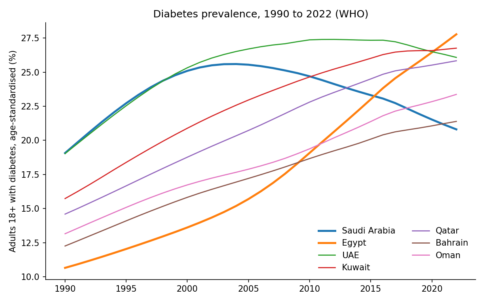
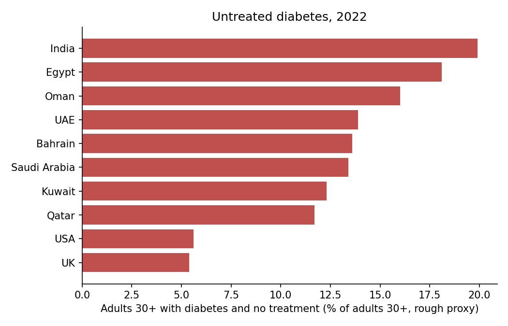

# Diabetes and related risk factors in the Gulf and Egypt

How big is the diabetes problem in Saudi Arabia, Egypt and the other Gulf countries, how fast did it grow, and how many people with diabetes are not getting treatment? I pulled WHO Global Health Observatory data for 7 countries and 3 comparators (USA, UK, India) and put the numbers side by side.

I work as a pharmacist, so the treatment gap is the number I care about most.

## Data

- WHO Global Health Observatory API (https://www.who.int/data/gho), pulled by `src/fetch.py`.
- Indicators: diabetes prevalence (age-standardised, adults 18+ and 30+), diabetes treatment coverage (30+), adult obesity (BMI 30+), raised blood pressure (30 to 79).
- The values are model estimates from pooled population surveys (NCD-RisC), not a count of patients. Each one comes with an uncertainty interval, and the intervals for single countries are wide. For example, Saudi Arabia 2022 is 20.8% with an interval of 12.2 to 31.1%.
- Raw pull: `data/who_ncd_gulf_egypt.csv`. Result tables are the other CSVs in `data/`.

## What I found

- Egypt's diabetes prevalence went from 10.6% in 1990 to 27.8% in 2022 (adults 18+, age-standardised). That is the biggest rise of the ten countries.
- Saudi Arabia started at 19.1% in 1990, peaked near 25.6% in the mid-2000s, and the WHO estimate falls to 20.8% by 2022. These are smooth modelled curves with wide intervals (Saudi 2022: 12.2 to 31.1%), so I would not claim the country got better. Egypt passes Saudi Arabia in 2016.
- In 2022 Kuwait (26.8%), Egypt (27.8%) and the UAE (26.1%) are at the top. The UK and USA are at 8.8% and 12.5%.
- Treatment coverage among adults 30+ with diabetes: Qatar 65%, Kuwait 65%, USA 66%, but Egypt 46%, Oman 47% and India 29%.
- Combining prevalence and coverage gives a rough "untreated share" of adults 30+: Egypt 18.1%, Oman 16.0%, Saudi Arabia 13.4%, against 5.4 to 5.6% in the UK and USA. It is prevalence x (1 minus coverage), a proxy and not a measured number.
- Obesity is very high in Egypt (43.9%), Qatar (42.0%) and Kuwait (40.4%). Across these 10 countries obesity and diabetes prevalence are only weakly related (correlation 0.17). With 10 points and countries like India (low obesity, high diabetes) that is not strong evidence either way.




## Limits

- Estimates, not registry counts. Countries with few surveys get more modelled numbers.
- Latest value per indicator can be from different years (obesity goes to 2024, blood pressure only to 2019, diabetes to 2022).
- The untreated share mixes two WHO series with different definitions. Treat it as a ranking aid.
- Age bands differ between indicators. Prevalence for rankings is 18+, the treatment calculation uses 30+ because coverage is only defined for 30+.
- I did not use diabetes death rates, because the only year available for these countries is 2004.

## Run it

```
pip install requests pandas matplotlib
python src/fetch.py
python src/analyze.py
```

## Next

Add the IDF Diabetes Atlas numbers for cost per patient, and break the Gulf countries into nationals and expatriates where national surveys allow it.
